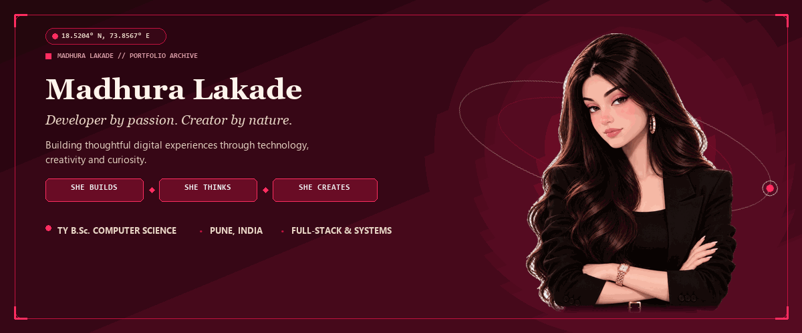
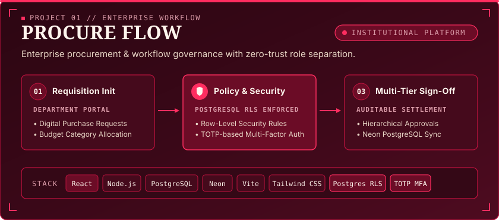
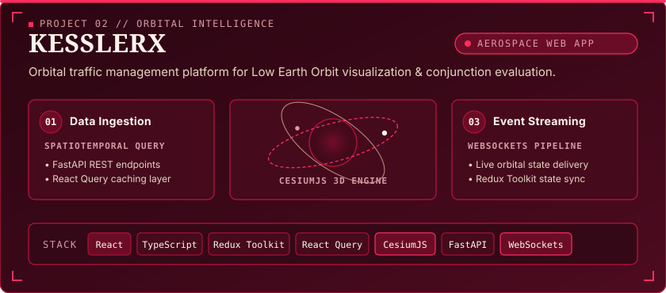
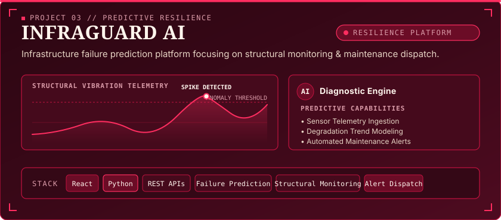
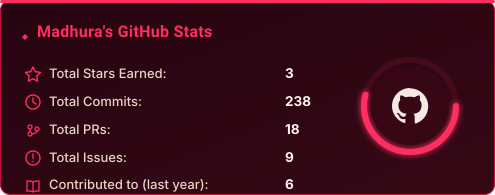
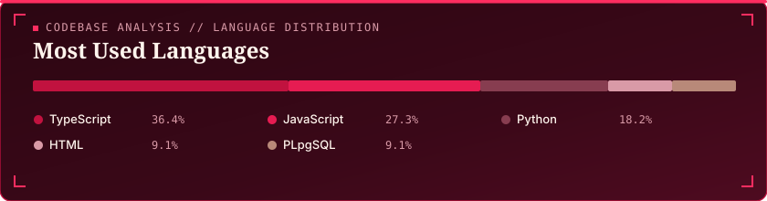
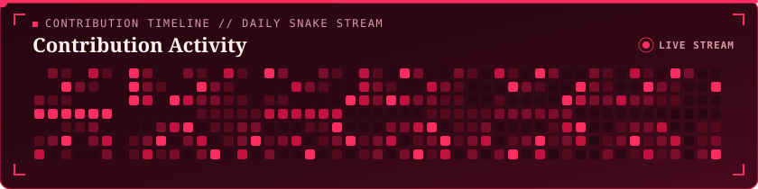

<!-- ======================================================== -->
<!-- 00. GITHUB THEME SELECTOR & MODE TOGGLE                   -->
<!-- ======================================================== -->

  
  &nbsp;
  
  &nbsp;
  

 

<!-- ======================================================== -->
<!-- 01. CREATIVE HERO WITH INTEGRATED PORTRAIT ARTWORK       -->
<!-- ======================================================== -->
<picture>
  <source media="(prefers-color-scheme: dark)" srcset="assets/hero/hero-banner-cherry.gif">
  <source media="(prefers-color-scheme: light)" srcset="assets/hero/hero-banner-cherry.gif">
  
</picture>

  

<!-- Interactive Live Portfolio Studio on GitHub Pages -->

  

 

<!-- Fast Quick-Connect Identity Strip -->

  
  &nbsp;&nbsp;
  
  &nbsp;&nbsp;
  

 

  

<!-- ======================================================== -->
<!-- 02. ABOUT MADHURA                                        -->
<!-- ======================================================== -->
## ✦ About Madhura

I'm a **Computer Science student** from Pune, India, with a **CGPA of 9.2+**, focused on building dependable full-stack applications, resilient backend systems and thoughtful interfaces.

I care about the gap between a demo and real software. My work spans an **institutional procurement and approval platform** secured with PostgreSQL Row-Level Security and TOTP-based MFA, and **KesslerX**, an orbital traffic monitoring dashboard with 3D satellite tracking. Beyond code, I present research, teach **cybersecurity awareness** as a Cyber Warrior with Quick Heal Foundation, and compete in hackathons with fellow developers.

> *Technical depth, clear communication, and the habit of finishing what I start.*

### By the numbers

| 🎓 CGPA | 🛰️ Projects | 🏆 Hackathons | 🎤 People reached | 🧰 Languages coded | 🗣️ Spoken |
|:---:|:---:|:---:|:---:|:---:|:---:|
| **9.2+** | **6** | **5+** | **2,000+** | **8** | **3** |

 

  

<!-- ======================================================== -->
<!-- 03. CURRENT FOCUS                                        -->
<!-- ======================================================== -->
## ✦ Current Focus

| | Area | What I'm doing |
|:---:|---|---|
| 🧱 | **Full-Stack Development** | Typed React frontends (TypeScript, Redux Toolkit, React Query) talking to Node.js and FastAPI backends |
| ⚡ | **Backend & Real-Time Systems** | REST API design, JWT auth, WebSocket event streaming |
| 🗄️ | **Database Design** | Relational schemas and serverless workflows with PostgreSQL and Neon |
| 🔐 | **Application Security** | Row-Level Security, TOTP-based MFA, defense-in-depth thinking |
| 🌍 | **Spatial & Data-Driven Apps** | Satellite tracking, live orbital data and 3D rendering with CesiumJS |

 

  

<!-- ======================================================== -->
<!-- 04. FEATURED WORK                                        -->
<!-- ======================================================== -->
## ✦ Featured Work

| Project | What it is | Stack |
|---|---|---|
| **[Procure Flow](https://sp-college-approval-hub.vercel.app)** | Procurement lifecycle and approval workflow platform for S.P. College, Pune | React · Node.js · PostgreSQL · Neon · RLS · MFA |
| **[KesslerX](https://kessler-x.vercel.app)** | Orbital debris and satellite monitoring for space situational awareness. Presented at Avishkar | React · TypeScript · CesiumJS · FastAPI · WebSockets |
| **InfraGuard AI** | Failure prediction and alerts for roads, bridges and pipelines | React · Python · REST APIs |

Also: NutriLens AI · Web Scraper · SkillSwap

 

### 01. PROCURE FLOW
> **Procurement lifecycle and approval workflow platform for S.P. College, Pune**

  

* **Architecture**: Institutional multi-tier requisition and sign-off pipeline built for S.P. College, Pune.
* **Key Capabilities**: Fine-grained access control via PostgreSQL Row-Level Security (RLS), TOTP-based Multi-Factor Authentication (MFA), auditable hierarchical sign-offs, and immutable requisition ledgers.
* **Technologies**: React, Node.js, PostgreSQL, Neon, Vite, Tailwind CSS, PostgreSQL Row-Level Security, TOTP-based Multi-Factor Authentication.
* **Deployment**: [Live Application &rarr;](https://sp-college-approval-hub.vercel.app/)

---

### 02. KESSLERX
> **Orbital debris and satellite monitoring for space situational awareness. Presented at Avishkar**

  

* **Architecture**: High-performance aerospace platform providing 3D orbital visualization and conjunction evaluation for Low Earth Orbit (LEO) assets. Selected and presented at the **Avishkar Research Convention** in Technology and Data.
* **Key Capabilities**: Real-time event streaming via WebSockets, spatiotemporal query caching using FastAPI and React Query, and interactive 3D geospatial rendering with CesiumJS.
* **Technologies**: React, TypeScript, Redux Toolkit, React Query, CesiumJS, Tailwind CSS, FastAPI, WebSockets.
* **Deployment**: [Live Application &rarr;](https://kessler-x.vercel.app/)

---

### 03. INFRAGUARD AI
> **Failure prediction and alerts for roads, bridges and pipelines**

  

* **Architecture**: Structural health monitoring and predictive failure intelligence system.
* **Key Capabilities**: Sensor telemetry ingestion, structural vibration degradation curve analysis, threshold anomaly classification, and automated preventive maintenance dispatch.
* **Technologies**: React, Python, REST APIs.

---

### Additional Projects

| Project | Focus &amp; Core Architecture | Technologies |
| :--- | :--- | :--- |
| **NutriLens AI** | Intelligent food recognition, dietary breakdown, and AI-assisted nutritional recommendations. | React, Python, REST APIs |
| **Web Scraper** | Automated high-throughput web scraping engine for structured dataset extraction and analysis. | Python, BeautifulSoup, Selenium |
| **SkillSwap** | Collaborative peer-to-peer knowledge sharing and skill exchange platform with real-time matching. | React, Node.js, Express.js |

 

  

<!-- ======================================================== -->
<!-- 05. TECHNOLOGY STACK                                     -->
<!-- ======================================================== -->
## ✦ Technology Stack

| Category | Domain Focus | Technologies &amp; Production Stack |
| :---: | :--- | :--- |
|  **Languages** | Core Programming |         |
|  **Frontend** | Reactive &amp; 3D Geospatial UI |         |
|  **Backend** | High-Throughput Services |       |
|  **Databases &amp; Security** | Relational, Cloud Realtime &amp; Security |         |
|  **Tools &amp; Ecosystem** | Workflows &amp; Automation |      |

 

  

<!-- ======================================================== -->
<!-- 06. BEYOND THE CODE                                      -->
<!-- ======================================================== -->
## ✦ Beyond the Code

Engineering excellence extends beyond codebases. I actively engage in cybersecurity education, research conventions, and collaborative problem-solving.

* **Quick Heal Foundation** &nbsp;•&nbsp; *Cyber Warrior (July – November 2025)*  
  Delivered comprehensive cybersecurity awareness training to over 2,000 individuals across schools and community forums, focusing on digital safety hygiene, online privacy protection, and financial scam mitigation.

* **Avishkar Research Convention** &nbsp;•&nbsp; *College-Level Research Presentation*  
  Selected to present research in the **Technology and Data** domain, featuring **KesslerX**—addressing orbital debris congestion, collision avoidance algorithms, and aerospace data visualization.

* **Competitive Hackathons** &nbsp;•&nbsp; *5+ Hackathons &amp; Ideathons*  
  Active participant in fast-paced software development hackathons, including the **FAR AWAY International Hackathon**, **AMD Slingshot Campus Days Ideathon 2026**, and **Hack the Flame**.

* **Sphere Community** &nbsp;•&nbsp; *Collaborative Development*  
  Engaged in technical knowledge exchanges, team-based open hackathon initiatives, and developer peer mentorship.

 

  

<!-- ======================================================== -->
<!-- 07. WORKING GITHUB STATISTICS                            -->
<!-- ======================================================== -->
## ✦ Working GitHub Statistics

Live metrics generated daily via automated GitHub Actions and official GitHub APIs.

  

  

 

  

<!-- ======================================================== -->
<!-- 08. CONTRIBUTION ACTIVITY & SNAKE ANIMATION              -->
<!-- ======================================================== -->
## ✦ Contribution Activity &amp; Snake Stream

  <picture>
    <source media="(prefers-color-scheme: dark)" srcset="assets/stats/snake-cherry.svg">
    <source media="(prefers-color-scheme: light)" srcset="assets/stats/snake-cherry.svg">
    
  </picture>

> 📊 **Live Activity**: Explore live commits, pull requests, and open-source contributions directly on the [GitHub Activity Timeline](https://github.com/madhura200227?tab=overview).

 

  

<!-- ======================================================== -->
<!-- 09. CONNECT — LINKEDIN & EMAIL                           -->
<!-- ======================================================== -->
## ✦ Connect

I welcome conversations around full-stack development, software architecture, research initiatives, and collaborative opportunities.

  
  &nbsp;&nbsp;
  
  &nbsp;&nbsp;
  

 

<!-- ======================================================== -->
<!-- 10. PERSONAL SIGNATURE FOOTER                            -->
<!-- ======================================================== -->

  

  <em>"Developer by passion. Creator by nature."</em>

