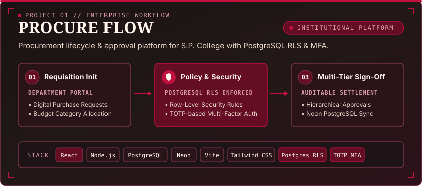
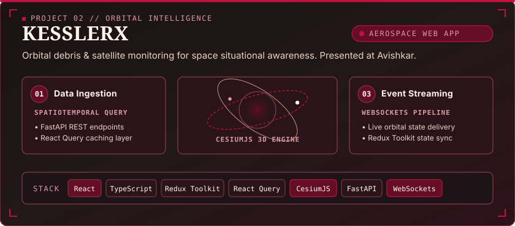
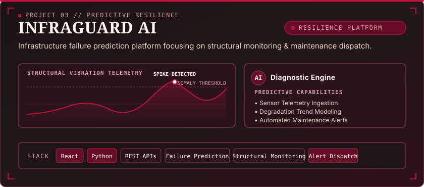
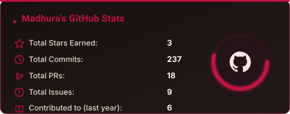
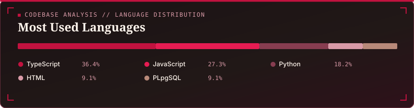
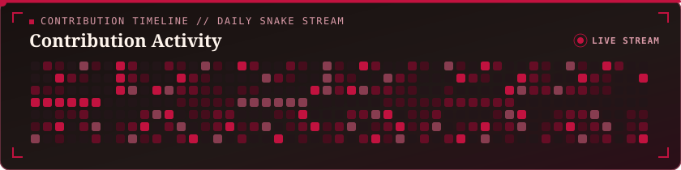

<!-- ======================================================== -->
<!-- 01. CREATIVE HERO WITH INTEGRATED PORTRAIT ARTWORK       -->
<!-- ======================================================== -->
<picture>
  <source media="(prefers-color-scheme: dark)" srcset="assets/hero/hero-banner.svg">
  <source media="(prefers-color-scheme: light)" srcset="assets/hero/hero-banner-cherry.svg">
  
</picture>

  

<!-- Fast Quick-Connect Identity Strip -->

  
  &nbsp;&nbsp;
  
  &nbsp;&nbsp;
  

 

  

<!-- ======================================================== -->
<!-- 02. ABOUT MADHURA                                        -->
<!-- ======================================================== -->
## ✦ About Madhura

I am a **Third Year B.Sc. Computer Science** student based in **Pune, India**, dedicated to architecting dependable full-stack applications, resilient backend systems, and thoughtful digital interfaces.

My engineering philosophy connects technical depth with clear product intuition. Rather than assembling proof-of-concept demos, I focus on building practical, production-minded software—from institutional workflow engines with zero-trust role-level security to 3D orbital trajectory simulation systems. Beyond application development, I conduct academic research, advocate for community cybersecurity awareness, compete in national and international hackathons, and collaborate with peer developers to build software that solves tangible problems.

---

<!-- ======================================================== -->
<!-- 03. CURRENT FOCUS                                        -->
<!-- ======================================================== -->
## ✦ Current Focus

Directing engineering efforts toward backend stability, security governance, and spatial analytics:

* **Full-Stack Application Development** — Architecting end-to-end reactive systems combining modular TypeScript frontend state with scalable, asynchronous API backends.
* **Backend Architecture & Distributed Systems** — Designing structured RESTful endpoints, real-time WebSocket event streaming, and decoupled service layers.
* **Database Design & Performance** — Relational schema design, index optimization, and modern serverless database workflows using Neon and PostgreSQL.
* **Application Security & Access Governance** — Implementing defense-in-depth principles, zero-trust PostgreSQL Row-Level Security (RLS), and TOTP-based Multi-Factor Authentication.
* **Data-Driven Applications & Spatial Visualization** — Spatiotemporal telemetry processing, predictive analytics modeling, and high-performance 3D geospatial rendering using CesiumJS.

 

  

<!-- ======================================================== -->
<!-- 04. TECHNOLOGY STACK                                     -->
<!-- ======================================================== -->
## ✦ Technology Stack

A restrained, categorized visual overview of verified languages, frameworks, and engineering tools applied across production repositories and research platforms.

| Category | Domain | Technologies |
| :--- | :--- | :--- |
|  | **Programming** | `Python` &nbsp;•&nbsp; `JavaScript` &nbsp;•&nbsp; `TypeScript` &nbsp;•&nbsp; `SQL` &nbsp;•&nbsp; `HTML5` &nbsp;•&nbsp; `CSS3` &nbsp;•&nbsp; `C` |
|  | **Frontend** | `React.js` &nbsp;•&nbsp; `Redux Toolkit` &nbsp;•&nbsp; `React Query` &nbsp;•&nbsp; `React Router` &nbsp;•&nbsp; `React Hook Form` &nbsp;•&nbsp; `Tailwind CSS` &nbsp;•&nbsp; `Vite` &nbsp;•&nbsp; `CesiumJS` |
|  | **Backend** | `Node.js` &nbsp;•&nbsp; `Express.js` &nbsp;•&nbsp; `FastAPI` &nbsp;•&nbsp; `REST APIs` &nbsp;•&nbsp; `WebSockets` &nbsp;•&nbsp; `JWT Authentication` |
|  | **Databases &amp; Security** | `PostgreSQL` &nbsp;•&nbsp; `Neon` &nbsp;•&nbsp; `PostgreSQL Row-Level Security` &nbsp;•&nbsp; `TOTP-based Multi-Factor Authentication` |
|  | **Tools &amp; Ecosystem** | `Git` &nbsp;•&nbsp; `GitHub` &nbsp;•&nbsp; `BeautifulSoup` &nbsp;•&nbsp; `Selenium` &nbsp;•&nbsp; `MS Office` &nbsp;•&nbsp; `Google Workspace` |

 

  

<!-- ======================================================== -->
<!-- 05. FEATURED PROJECTS                                    -->
<!-- ======================================================== -->
## ✦ Featured Projects

### 01. PROCURE FLOW
> **Enterprise Procurement &amp; Institutional Workflow Platform**

  

* **Architecture**: Multi-tier institutional approval platform with zero-trust role-based governance.
* **Key Capabilities**: Fine-grained access control via PostgreSQL Row-Level Security (RLS), TOTP-based Multi-Factor Authentication (MFA), auditable sign-off pipelines, and immutable requisition ledgers.
* **Technologies**: React, Node.js, PostgreSQL, Neon, Vite, Tailwind CSS, PostgreSQL Row-Level Security, TOTP-based Multi-Factor Authentication.
* **Deployment**: [Live Application &rarr;](https://sp-college-approval-hub.vercel.app/)

---

### 02. KESSLERX
> **Orbital Traffic Management &amp; Conjunction Assessment Platform**

  

* **Architecture**: High-performance aerospace web application providing 3D orbital visualization and conjunction evaluation for Low Earth Orbit (LEO) assets.
* **Key Capabilities**: Real-time event streaming via WebSockets, spatiotemporal query caching using FastAPI and React Query, and interactive 3D geospatial rendering with CesiumJS.
* **Technologies**: React, TypeScript, Redux Toolkit, React Query, CesiumJS, Tailwind CSS, FastAPI, WebSockets.
* **Deployment**: [Live Application &rarr;](https://kessler-x.vercel.app/)

---

### 03. INFRAGUARD AI
> **Infrastructure Failure Prediction &amp; Monitoring Platform**

  

* **Architecture**: Structural health monitoring and predictive failure intelligence system.
* **Key Capabilities**: Sensor telemetry ingestion, structural vibration degradation curve analysis, threshold anomaly classification, and automated preventive maintenance dispatch.
* **Technologies**: React, Python, REST APIs.

---

### Additional Projects

| Project | Focus &amp; Core Architecture | Technologies |
| :--- | :--- | :--- |
| **NutriLens AI** | Intelligent food recognition, dietary breakdown, and AI-assisted nutritional recommendations. | React, Python, REST APIs |
| **Web Scraper** | Automated high-throughput web scraping engine for structured dataset extraction and analysis. | Python, BeautifulSoup, Selenium |
| **SkillSwap** | Collaborative peer-to-peer knowledge sharing and skill exchange platform with real-time matching. | React, Node.js, Express.js |

 

  

<!-- ======================================================== -->
<!-- 06. BEYOND THE CODE                                      -->
<!-- ======================================================== -->
## ✦ Beyond the Code

Engineering excellence extends beyond codebases. I actively engage in cybersecurity education, research conventions, and collaborative problem-solving.

* **Quick Heal Foundation** &nbsp;•&nbsp; *Cyber Warrior (July – November 2025)*  
  Delivered comprehensive cybersecurity awareness training to over 2,000 individuals across schools and community forums, focusing on digital safety hygiene, online privacy protection, and financial scam mitigation.

* **Avishkar Research Convention** &nbsp;•&nbsp; *College-Level Research Presentation*  
  Selected to present research in the **Technology and Data** domain, featuring **KesslerX**—addressing orbital debris congestion, collision avoidance algorithms, and aerospace data visualization.

* **Competitive Hackathons** &nbsp;•&nbsp; *5+ Hackathons &amp; Ideathons*  
  Active participant in fast-paced software development hackathons, including the **FAR AWAY International Hackathon**, **AMD Slingshot Campus Days Ideathon 2026**, and **Hack the Flame**.

* **Sphere Community** &nbsp;•&nbsp; *Collaborative Development*  
  Engaged in technical knowledge exchanges, team-based open hackathon initiatives, and developer peer mentorship.

 

  

<!-- ======================================================== -->
<!-- 07. WORKING GITHUB STATISTICS                            -->
<!-- ======================================================== -->
## ✦ Working GitHub Statistics

Live metrics generated daily via automated GitHub Actions and official GitHub APIs.

  

  

 

  

<!-- ======================================================== -->
<!-- 08. CONTRIBUTION ACTIVITY & SNAKE ANIMATION              -->
<!-- ======================================================== -->
## ✦ Contribution Activity &amp; Snake Stream

  <picture>
    <source media="(prefers-color-scheme: dark)" srcset="assets/stats/snake.svg">
    <source media="(prefers-color-scheme: light)" srcset="assets/stats/snake-cherry.svg">
    
  </picture>

> 📊 **Live Activity**: Explore live commits, pull requests, and open-source contributions directly on the [GitHub Activity Timeline](https://github.com/madhura200227?tab=overview).

 

  

<!-- ======================================================== -->
<!-- 09. CONNECT — LINKEDIN & EMAIL                           -->
<!-- ======================================================== -->
## ✦ Connect

I welcome conversations around full-stack development, software architecture, research initiatives, and collaborative opportunities.

  
  &nbsp;&nbsp;
  
  &nbsp;&nbsp;
  

 

<!-- ======================================================== -->
<!-- 10. PERSONAL SIGNATURE FOOTER                            -->
<!-- ======================================================== -->

  

  <em>"Developer by passion. Creator by nature."</em>

